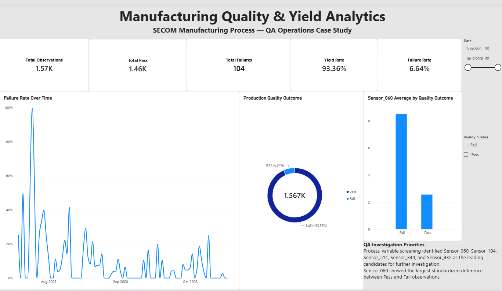

# Manufacturing Quality & Yield Analytics

## Overview

This project analyzes manufacturing process data to evaluate quality
performance, identify process variables associated with production
failures, and prioritize areas for further Quality Operations investigation.

The analysis was developed as a manufacturing quality analytics case study
using the SECOM dataset from the UCI Machine Learning Repository.

## Dashboard Preview

## Business Question

Which process measurements show the strongest relationship with
manufacturing failures, and where should Quality Operations prioritize
further investigation?

## Tools Used

- Python
- Pandas
- NumPy
- Matplotlib
- Power BI
- Jupyter Notebook

## Dataset

The SECOM dataset contains anonymized semiconductor manufacturing process
measurements with Pass/Fail production outcomes.

The analyzed dataset contained:

- 1,567 production observations
- 590 process measurement variables
- 1,463 passing observations
- 104 failed observations

## Data Preparation

The analysis included:

- Validation of process measurements and quality labels
- Missing-data assessment
- Removal of non-informative and high-missingness variables
- Median imputation for remaining missing measurements
- Creation of time-based quality indicators
- Preservation of the original raw data
- Creation of a cleaned analytical dataset

## Key Results

### Overall Quality Performance

- Yield Rate: **93.36%**
- Failure Rate: **6.64%**
- Passed: **1,463**
- Failed: **104**

### Process Variable Screening

Process measurements were screened by comparing standardized differences
between passing and failing observations.

The five leading candidates for further investigation were:

1. Sensor_060
2. Sensor_104
3. Sensor_511
4. Sensor_349
5. Sensor_432

Sensor_060 showed the largest standardized difference between Pass and Fail
observations and was selected for deeper investigation.

### Exploratory Process Monitoring

For Sensor_060:

- Process Mean: **2.951**
- Upper exploratory 3-sigma limit: **31.487**
- Lower exploratory 3-sigma limit: **-25.584**
- Observations outside limits: **5**

Only one of the five observations outside the exploratory limits was a
failed observation. Therefore, extreme Sensor_060 readings alone do not
explain manufacturing failures.

Sensor_060 should be considered a candidate for further investigation,
not a confirmed root cause of failure.

## Quality Operations Recommendation

The analysis suggests prioritizing Sensor_060 and the other identified
process variables for further investigation.

In a production environment, the next steps would include reviewing the
physical process parameters represented by these variables, validating
measurement systems, investigating failure records, and using root-cause
analysis to determine whether the observed relationships are causal.

## Dashboard

The Power BI dashboard provides:

- Overall yield and failure KPIs
- Failure-rate trend monitoring
- Pass/Fail distribution
- Sensor_060 comparison between quality outcomes
- Interactive date and quality-status filters

## Repository Structure

- `data/raw/` - original SECOM files
- `data/processed/` - cleaned and analytical datasets
- `notebooks/` - Python analysis notebook
- `visuals/` - analytical charts
- `dashboard/` - Power BI dashboard

## Disclaimer

This is an independent portfolio project for educational and professional
development purposes. It is not affiliated with the
original manufacturing organization represented by the dataset.

Data source: UCI Machine Learning Repository — SECOM Dataset.